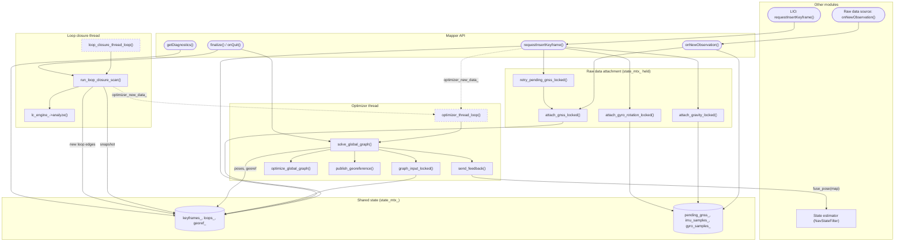

# Mapper: call graph

Threads and call flow of `mola::mapper::Mapper`. Update this whenever methods
are added, renamed, or the call structure changes.

Styles: rounded boxes are public API, sharp boxes are internal helpers, and
dashed boxes are background threads.

## Keyframe insertion

`requestInsertKeyframe()` is called by the front end (LIO) and returns the new
keyframe index.

1. Under `state_mtx_`, a keyframe not newer than the last one is rejected
   (`std::nullopt`).
2. The initial pose in the map frame is the newest keyframe estimate plus the
   front end increment, if both keyframes share the source frame; the first
   keyframe defines the map frame.
3. `attach_gravity_locked()` averages the accelerometer readings of the
   `imu_gravity_window` before the keyframe and stores them as a
   `CObservationIMU` in the keyframe auxiliary observations (needs
   `imu_gravity_min_samples`).
4. `attach_gyro_rotation_locked()` integrates the gyroscope readings between the
   previous keyframe and this one (`integrate_gyro()`), with the bias from the
   first `mola::ImuBiasSource` that has an estimate, else zero with
   `gyro_bias_sigma`. The rotation is rotated to the vehicle frame and stored
   with its sigma.
   With wheel odometry, `attach_wheel_odom_locked()` stores its increment since
   the previous keyframe (`wheel_odometry_increment()`), or queues the keyframe in
   `pending_wheel_odom_` until the readings reach its stamp.
5. `retry_pending_gnss_locked()` re-attempts the GNSS readings that were waiting
   for a keyframe.
6. After releasing the lock, `optimizer_new_data_` is set and the optimizer
   thread is woken.

## Raw data attachment

`onNewObservation()` filters by sensor label regex (`gnss_sensor_labels_re`,
`imu_sensor_labels_re`, `gyro_sensor_labels_re`, `image_sensor_labels_re`,
`wheel_odom_sensor_labels_re`) and
stores under `state_mtx_`:

- GNSS: `attach_gnss_locked()` keeps the reading pending until a keyframe at or
  after its stamp exists. Then it is attached to the nearest keyframe within
  `gnss_max_time_offset`; a keyframe keeps only its closest reading
  (`attach_nearest_locked()`, slot "gnss").
- Images: the same rule (slot "image:<label>", `pending_images_`). Once a later
  image of that camera is farther from the keyframe than the attached one (and a
  newer keyframe exists), `finish_images_locked()` swaps it for a copy referring
  to a file, written by the `disk_io_` thread; `finalize()` waits for those
  writes before saving the outputs. Images are not recorded (`record_input`) nor
  passed to the graph input.
- Accelerometer: queued in `imu_samples_` (window plus a few seconds).
- Gyroscope: the first IMU label matching `gyro_sensor_labels_re` is queued in
  `gyro_samples_` (last 60 s).
- Wheel odometry (`CObservationOdometry`): the first matching label is queued in
  `wheel_odom_samples_` (last 60 s, and always back to the keyframe the next
  increment starts at); each reading retries `pending_wheel_odom_` (a throttled
  warning if many keyframes wait).

## Optimizer thread

`optimizer_thread_loop()` waits for `optimizer_new_data_` (new keyframe, new
GNSS reading, or new loop edges) and calls `solve_global_graph()`, at most once
every `optimizer_min_period`. With `enable_optimizer_thread: false`, only
`optimize_now()` solves.

`solve_global_graph()` (one solve at a time, `solve_mtx_`):

1. Copies the graph input under `state_mtx_` (`graph_input_locked()`), then
   releases it.
2. Runs `optimize_global_graph()` (see `GlobalGraph.h`): GTSAM batch
   Levenberg-Marquardt over the keyframe poses `P(i)` and `T_enu_to_map` `T(0)`,
   plus marginal covariances.
3. Under `state_mtx_`, stores the optimized poses. Keyframes inserted while
   solving are re-chained onto the new estimates. Stores the datum and the
   geo-reference.
4. Publishes the geo-reference through `advertiseUpdatedMap()`
   (`publish_georeference()`), if there is one.
5. `send_feedback()`, if `feedback_to_state_estimator` is true: finds the single
   `NavStateFilter` module and calls `fuse_pose(stamp, pose, reference_frame_name)`
   with the optimized pose of the newest keyframe, its marginal covariance
   floored by `feedback_min_sigma_xyz` and `feedback_min_sigma_ang_deg`.
6. If the solve added loop closures and `local_map_corrections` is true,
   `advertise_local_map_correction()` (`mola::LocalMapCorrectionSource`), still
   under `solve_mtx_` but not `state_mtx_`. Subscribers (LIO) then call
   `local_map_keyframes()`, which copies the keyframes near a reference one
   under `state_mtx_`.

## Loop closure thread

Started by `initialize()` if `loop_closure_enabled`. It uses a
`mola::FrameToFrameLoopClosure` engine (pipeline in
`loop_closure_pipeline_file`) only as a detector (`analyze()`).

`loop_closure_thread_loop()` wakes every `loop_closure_check_period_sec` or on
`request_loop_closure_scan()`, and calls `run_loop_closure_scan()`:

1. Under `state_mtx_`, builds a `CSimpleMap` snapshot of the keyframe poses and
   front end observations, and the pairs already closed. Without a forced scan,
   it returns if fewer than `loop_closure_min_new_keyframes` keyframes are new.
2. The scan is incremental (only pairs with a new keyframe), or full if forced,
   if `loop_closure_incremental` is false, or every
   `loop_closure_full_scan_every_n` incremental scans.
3. `analyze()` runs without the lock. The edges are sorted by keyframe pair, so
   the result does not depend on thread timing.
4. `merge_loop_edges()`: under `state_mtx_`, the odometry check of the new
   pairs. Without the consistency check, they are appended to `loops_`.
   With it, they join `lc_gate_` (all loops that passed the odometry check),
   which decides again, without the lock, the groups of neighbor loops they
   join; then `loops_` is set to the accepted ones. If `loops_` changed (also
   `loops_revision_`, which triggers a local map correction after the next
   solve), the optimizer is woken.

`wait_for_loop_closure_idle()` blocks until no scan is running or requested.

## Finalize

`finalize()` runs once, from `onQuit()` or the destructor:

1. Stops the loop closure and optimizer threads.
2. `optimize_now()`.
3. If loop closure is enabled, up to `loop_closure_finalize_rounds` rounds of a
   full scan (in the calling thread) followed by `optimize_now()`, stopping at
   the first round without new loops.
4. `save_outputs()`: graph input, TUM trajectory, geo-reference, state estimator
   trajectory and geo-reference, loop closures and simplemap, for the
   `output_*` parameters that are set.

## Invariants

- `state_mtx_` guards keyframes, loops, georeference and pending data. Never
  call other modules (state estimator, loop closure engine, publishers) with it
  held.
- The loop closure engine and the optimizer only work on copies taken under
  `state_mtx_`.
- The map frame is the one of the first keyframe pose in the front end source
  frame, which is also where the state estimator starts.
